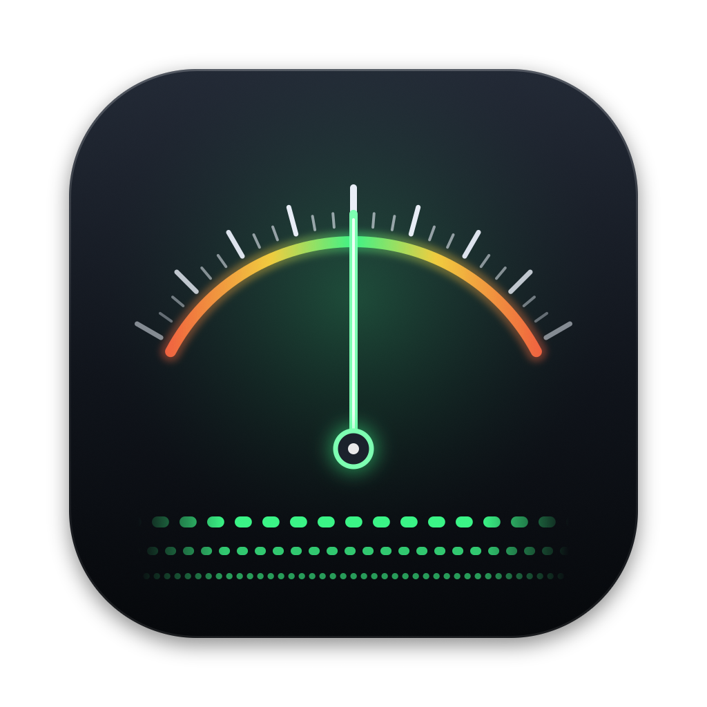

<p align="center">
  
</p>

<h1 align="center">TunerX</h1>

<p align="center">
  <b>High-precision chromatic guitar tuner for macOS</b><br>
  Native Swift · Metal rendering · CoreAudio · sub-0.05-cent accuracy
</p>

<p align="center">
  <a href="https://github.com/lydianb79/TunerX/releases/latest"></a>
  
  
</p>

---

## Download

| Your Mac | Download |
|---|---|
| Apple Silicon (M1 or later) | [**TunerX-arm64.zip**](https://github.com/lydianb79/TunerX/releases/latest/download/TunerX-arm64.zip) |
| Intel | [**TunerX-x86_64.zip**](https://github.com/lydianb79/TunerX/releases/latest/download/TunerX-x86_64.zip) |

All versions are listed under [Releases](https://github.com/lydianb79/TunerX/releases). To check which Mac you have, open  → *About This Mac*: **Chip** means Apple Silicon, **Processor** means Intel.

### Install
1. Unzip, then move **TunerX** to your *Applications* folder.
2. The builds are ad-hoc signed and **not notarized**, so the first launch needs one extra step. **Right-click TunerX → Open → Open**, or allow it under *System Settings → Privacy & Security*. You can also remove the quarantine flag in Terminal:
   ```bash
   xattr -dr com.apple.quarantine /Applications/TunerX-arm64.app
   ```
3. Allow **microphone access** when asked. macOS needs this for every audio input, including USB/Thunderbolt audio interfaces.

## Quick start
1. In the sidebar, choose your **Input** device and **Channel**. For example, pick your audio interface and *Input 1* for a guitar plugged into the first input.
2. Play a single string. TunerX finds the note automatically.
3. Tune until the needle is centred, the readout turns **green** and the **strobe stands still**. If the strobe drifts left you're flat; if it drifts right you're sharp.
4. Optional: choose an **Output** device to hear a pure **reference tone** or to **monitor** your input (use headphones).

For lowest latency, use a small **Buffer size** (64–128 samples). For maximum precision, set the analysis **Window** to *Precise* or *Ultra*. The two settings are independent of each other.

## Features
- **Automatic chromatic detection** from about 25 Hz to 2 kHz: 6- and 7-string guitar, bass, and up to the highest frets.
- **Four Metal instruments**, drawn at up to 120 fps with 4× MSAA:
  1. **Strobe**: three virtual strobe bands. The pattern stands still when the note is in tune and drifts toward flat or sharp, faster the further off it is.
  2. **Chromatic wide scale**: a scrolling tape covering ±6 semitones, with note names, 10-cent ticks and an in-tune window.
  3. **Fine scale**: ±50 cents with 1-cent divisions.
  4. **Micro scale**: ±5 cents with 0.1-cent divisions.
- **Readout**: the note, the deviation to 0.01 cent, the measured and target frequencies to 0.0001 Hz, the deviation in Hz, and the detection clarity.
- **Audio interface support**: choose any input device and channel (or *Mix all*), and any output device.
- **Driver settings**: buffer size (16–4096 samples, limited to what the device supports) and sample rate. The active latency is shown.
- **Reference tone**: a pure sine that follows the detected note or stays on a fixed string. **Input monitoring** is also available.
- **Adjustable** A4 reference (400–480 Hz in 0.1 Hz steps), analysis window, smoothing and noise gate. Settings are kept between launches.

## Precision
Pitch detection works in two stages:
1. **McLeod Pitch Method** (NSDF from an FFT autocorrelation) gives a robust estimate without octave errors, accurate to about ±1 cent.
2. A **phase-difference refinement** measures two Hann-windowed segments at the estimated frequency. The phase advance between them gives the fundamental frequency with very fine resolution.

Simulated guitar tones (7 inharmonic partials, decaying envelope, noise at −40 dB, 48 kHz) gave these worst-case errors from E1 to E6:

| Window | Size @48k | Worst error |
|---|---|---|
| Fast | 4096 | ~0.9 ¢ (low notes fall back to stage 1) |
| Balanced | 8192 | ~0.8 ¢ at E1, < 0.02 ¢ from E2 up |
| **Precise** (default) | 16384 | **< 0.035 ¢** |
| Ultra | 32768 | **< 0.005 ¢** |

The audio buffer size only changes **latency**. Precision depends on the analysis window.

## Build from source
Requirements: macOS 13 or later, and Xcode 15 or later (or the Swift 5.9+ command-line tools).

```bash
git clone https://github.com/lydianb79/TunerX.git
cd TunerX

./build_app.sh          # build/TunerX.app for this Mac (release, ad-hoc signed)
open build/TunerX.app

./build_arch.sh         # build/TunerX-arm64.app + build/TunerX-x86_64.app, plus a .zip of each
```

`build_arch.sh` uses a separate build folder for each architecture. It labels the apps "TunerX (Apple Silicon)" and "TunerX (Intel)", and uses `lipo` to check that each binary contains only its own architecture.

To develop in Xcode, run `open Package.swift`. For microphone access, run the app bundle produced by the build scripts. A bare executable launched from Xcode has no `NSMicrophoneUsageDescription` and gets no audio input.

### Publishing a release
```bash
./build_arch.sh
gh release create vX.Y.Z --target main --title "TunerX X.Y.Z" \
  --notes-file RELEASE_NOTES.md build/TunerX-arm64.zip build/TunerX-x86_64.zip
```
Keep the asset names unchanged: the download links above point to `releases/latest/download/<asset name>`.

## Project layout
```
Package.swift
Sources/TXCore/            lock-free C11 ring buffer (realtime-safe)
Sources/TunerX/
  TunerXApp.swift          app entry point
  AudioDevices.swift       CoreAudio HAL: devices, channels, buffer sizes, sample rates, latency
  AudioEngine.swift        AUHAL input and output units, realtime callbacks, reference tone, monitoring
  PitchDetector.swift      MPM + phase-difference refinement (Accelerate)
  TunerModel.swift         settings, device handling, analysis thread, note tracking and smoothing
  TunerRenderer.swift      Metal renderer (strobe, wide scale, ±50 ¢, ±5 ¢)
  Shaders.swift            MSL source, compiled at runtime
  GlyphAtlas.swift         CoreText → Metal texture for on-GPU labels
  Views.swift              SwiftUI header, settings sidebar, level meter
Resources/                 Info.plist, entitlements, AppIcon.icns, AppIcon.png (1024 px)
build_app.sh               build for this Mac
build_arch.sh              separate arm64 and x86_64 builds and zips
```

## Notes
- The buffer size setting changes the device's IO buffer for TunerX only. The sample rate setting changes the device's nominal rate, which affects the whole system.
- Monitoring and the reference tone run at the input sample rate. The AUHAL converts them to the output device's rate.
- If you monitor through speakers while the input is a microphone, the tuner will hear its own reference tone. Use headphones.
