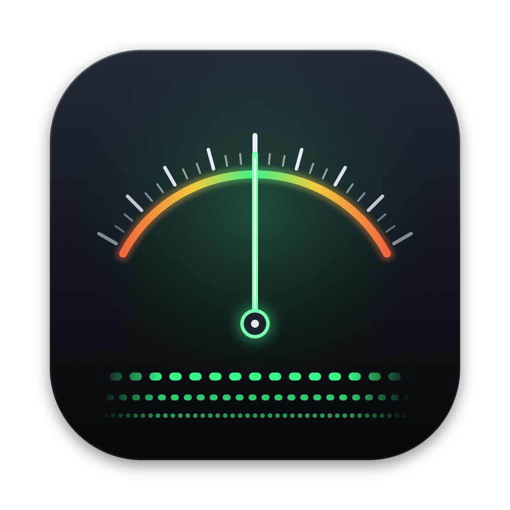

<p align="center">
  
</p>

<h1 align="center">TunerX</h1>

<p align="center">
  <b>High-precision chromatic guitar tuner for macOS</b><br>
  Native Swift · Metal rendering · CoreAudio · sub-0.05-cent accuracy
</p>

<p align="center">
  <a href="https://github.com/lydianb79/TunerX/releases/latest"></a>
  
  
</p>

---

## Download

| Your Mac | Download |
|---|---|
| Apple Silicon (M1 or later) | [**TunerX-arm64.zip**](https://github.com/lydianb79/TunerX/releases/latest/download/TunerX-arm64.zip) |
| Intel | [**TunerX-x86_64.zip**](https://github.com/lydianb79/TunerX/releases/latest/download/TunerX-x86_64.zip) |

All versions are listed under [Releases](https://github.com/lydianb79/TunerX/releases). To check which Mac you have, open  → *About This Mac*: **Chip** means Apple Silicon, **Processor** means Intel.

### Install
1. Unzip, then move **TunerX** to your *Applications* folder.
2. The builds are ad-hoc signed and **not notarized**, so the first launch needs one extra step. **Right-click TunerX → Open → Open**, or allow it under *System Settings → Privacy & Security*. You can also remove the quarantine flag in Terminal:
   ```bash
   xattr -dr com.apple.quarantine /Applications/TunerX-arm64.app
   ```
3. Allow **microphone access** when asked. macOS needs this for every audio input, including USB/Thunderbolt audio interfaces.

## Quick start
1. In the sidebar, choose your **Input** device and **Channel**. For example, pick your audio interface and *Input 1* for a guitar plugged into the first input.
2. Play a single string. TunerX finds the note automatically.
3. Tune until the needle is centred, the readout turns **green** and the **strobe stands still**. If the strobe drifts left you're flat; if it drifts right you're sharp.
4. Optional: choose an **Output** device to hear a pure **reference tone** or to **monitor** your input (use headphones).

For lowest latency, use a small **Buffer size** (64–128 samples). For maximum precision, set the analysis **Window** to *Precise* or *Ultra*. The two settings are independent of each other.

## Features
- **Automatic chromatic detection** from about 25 Hz to 2 kHz: 6- and 7-string guitar, bass, and up to the highest frets.
- **Four Metal instruments**, drawn at up to 120 fps with 4× MSAA:
  1. **Strobe**: three virtual strobe bands. The pattern stands still when the note is in tune and drifts toward flat or sharp, faster the further off it is.
  2. **Chromatic wide scale**: a scrolling tape covering ±6 semitones, with note names, 10-cent ticks and an in-tune window.
  3. **Fine scale**: ±50 cents with 1-cent divisions.
  4. **Micro scale**: ±5 cents with 0.1-cent divisions.
- **Readout**: the note, the deviation to 0.01 cent, the measured and target frequencies to 0.0001 Hz, the deviation in Hz, and the detection clarity.
- **Audio interface support**: choose any input device and channel (or *Mix all*), and any output device.
- **Driver settings**: buffer size (16–4096 samples, limited to what the device supports) and sample rate. The active latency is shown.
- **Reference tone**: a pure sine that follows the detected note or stays on a fixed string. **Input monitoring** is also available.
- **Output transparency**: TunerX only runs the output device while the reference tone or monitoring is on, and it shows a meter of exactly what it sends. With both off, TunerX makes no sound at all. An optional **exclusive output** mode (hog mode) keeps other apps off the output device while TunerX runs.
- **Mains-hum filter** (Auto, 50 Hz, 60 Hz or Off): narrow notches at the mains frequency and its harmonics remove hum from single-coil pickups and ground loops before analysis. Auto measures the hum while you're not playing.
- **Adjustable** A4 reference (400–480 Hz in 0.1 Hz steps), analysis window, smoothing and noise gate. Settings are kept between launches.

## Settings reference
| Section | Setting | What it does |
|---|---|---|
| Input | Device / Channel | Where TunerX listens. *Mix all* averages every input channel. |
| Output | Device | Where the reference tone and monitoring play. *None* means TunerX can never make sound. |
| | Reference tone / Tone pitch / Tone level | Plays a pure sine at the detected note or at a fixed string. |
| | Input monitoring / Monitor level | Passes your input through to the output. |
| | TunerX out (meter + status) | Shows exactly what TunerX is sending. *Silent* means the output device isn't even running. |
| | Exclusive output | Takes the output device in hog mode, so no other app can play through it while TunerX runs. |
| Driver | Buffer size | IO buffer size. Smaller means lower latency; it doesn't change precision. |
| | Sample rate | The device's nominal rate. Changing it affects the whole system. |
| Analysis | Window | Analysis length: Fast, Balanced, Precise or Ultra. Low notes automatically get at least 24 periods. |
| | Reference A4 | Concert pitch, 400–480 Hz. |
| | Smoothing | Steadiness versus responsiveness of the readout. |
| | Noise gate | Signals below this RMS level are ignored. |
| | Hum filter | Removes 50/60 Hz mains hum and its harmonics before analysis. *Auto* measures it while you're not playing. |

## Precision
Pitch detection works in two stages:
1. **McLeod Pitch Method** (NSDF from an FFT autocorrelation) gives a robust estimate without octave errors, accurate to about ±1 cent.
2. A **phase-difference refinement** measures two Hann-windowed segments at the estimated frequency. The phase advance between them gives the fundamental frequency with very fine resolution.

Simulated guitar tones (7 inharmonic partials, decaying envelope, noise at −40 dB, 48 kHz) gave these worst-case errors from E1 to E6:

| Window | Size @48k | Worst error |
|---|---|---|
| Fast | 4096 | ~0.9 ¢ (low notes fall back to stage 1) |
| Balanced | 8192 | ~0.8 ¢ at E1, < 0.02 ¢ from E2 up |
| **Precise** (default) | 16384 | **< 0.035 ¢** |
| Ultra | 32768 | **< 0.005 ¢** |

The audio buffer size only changes **latency**. Precision depends on the analysis window.

### Low strings
Wound low strings are hard to tune for two reasons, and TunerX handles both:
- **Weak fundamental**: through a microphone, a low E's fundamental (82 Hz) is often 20–40 dB below its 2nd–6th harmonics. Those harmonics also run sharp, because the string is stiff (fₕ = h·f₀·√(1+B·h²)). Simply dividing one harmonic by its number reads 1–2 ¢ sharp. Instead, TunerX measures every harmonic up to 1.6 kHz and fits the stiff-string model to all of them, each weighted by its signal-to-noise ratio. The fundamental is used on its own only when it is strong.
- **Mains hum**: 50/60 Hz hum and its harmonics sit right in the low-string range. Without filtering, hum can pull a dying low E down an octave, then lock the display onto the hum itself (G1 +35 ¢). It also biases nearby notes such as D3 (146.8 Hz, next to 150 Hz). The hum filter removes this.
- **Adaptive window**: low notes automatically get a window at least 24 periods long, even when *Fast* is selected.

In simulation (realistic plucked strings, B = 1–3·10⁻⁴, mic roll-off, 50 Hz hum at −35 dBFS), v1.1 shows no wrong-note readings on B1, D2, E2, A2 or E1 bass, against 20–98 % of frames in v1.0. Bias drops from 1–2 ¢ to under 0.1 ¢.

## Troubleshooting
- **I hear sound but the reference tone and monitoring are off.** Check the *TunerX out* status. If it says *Silent*, TunerX isn't running the output device at all. The sound is coming from your audio interface's direct or hardware monitoring, or from another app. Turn on *Exclusive output* to keep other apps off that device.
- **Low strings jump an octave or show G1/A♯1 when nothing is playing.** That is mains hum. Set *Hum filter* to *Auto*, or to your mains frequency (50 Hz in Europe, 60 Hz in North America). Auto needs a few seconds of quiet to measure it.
- **The readout is jumpy.** Raise *Smoothing*, choose a longer *Window*, or raise the *Noise gate* if the room is noisy.
- **No input level.** Allow microphone access in *System Settings → Privacy & Security → Microphone*. macOS requires it for audio interfaces too. Then check the input *Channel*.
- **The tuner reads its own tone.** You're using speakers with a microphone. Use headphones, or turn the reference tone off while you measure.

## Build from source
Requirements: macOS 13 or later, and Xcode 15 or later (or the Swift 5.9+ command-line tools).

```bash
git clone https://github.com/lydianb79/TunerX.git
cd TunerX

./build_app.sh          # build/TunerX.app for this Mac (release, ad-hoc signed)
open build/TunerX.app

./build_arch.sh         # build/TunerX-arm64.app + build/TunerX-x86_64.app, plus a .zip of each
```

`build_arch.sh` uses a separate build folder for each architecture. It labels the apps "TunerX (Apple Silicon)" and "TunerX (Intel)", and uses `lipo` to check that each binary contains only its own architecture.

To develop in Xcode, run `open Package.swift`. For microphone access, run the app bundle produced by the build scripts. A bare executable launched from Xcode has no `NSMicrophoneUsageDescription` and gets no audio input.

### Publishing a release
```bash
./build_arch.sh
gh release create vX.Y.Z --target main --title "TunerX X.Y.Z" \
  --notes-file RELEASE_NOTES.md build/TunerX-arm64.zip build/TunerX-x86_64.zip
```
Keep the asset names unchanged: the download links above point to `releases/latest/download/<asset name>`.

## Project layout
```
Package.swift
Sources/TXCore/            lock-free C11 ring buffer (realtime-safe)
Sources/TunerX/
  TunerXApp.swift          app entry point
  AudioDevices.swift       CoreAudio HAL: devices, channels, buffer sizes, sample rates, latency
  AudioEngine.swift        AUHAL input and output units, realtime callbacks, reference tone, monitoring
  PitchDetector.swift      MPM + phase-vocoder refinement + stiff-string fit (Accelerate)
  HumFilter.swift          mains-hum notch filter, 50/60 Hz auto-detection, sample history
  TunerModel.swift         settings, device handling, analysis thread, note tracking and smoothing
  TunerRenderer.swift      Metal renderer (strobe, wide scale, ±50 ¢, ±5 ¢)
  Shaders.swift            MSL source, compiled at runtime
  GlyphAtlas.swift         CoreText → Metal texture for on-GPU labels
  Views.swift              SwiftUI header, settings sidebar, level meters
Resources/                 Info.plist, entitlements, AppIcon.icns, AppIcon.png (1024 px)
build_app.sh               build for this Mac
build_arch.sh              separate arm64 and x86_64 builds and zips
```

## Notes
- The buffer size setting changes the device's IO buffer for TunerX only. The sample rate setting changes the device's nominal rate, which affects the whole system.
- Monitoring and the reference tone run at the input sample rate. The AUHAL converts them to the output device's rate.
- If you monitor through speakers while the input is a microphone, the tuner will hear its own output. TunerX warns when the built-in mic and built-in speakers are both selected. Use headphones.
- Exclusive output (hog mode) also blocks system sounds on that device. TunerX releases it when it quits or when you turn the option off.

## Changelog
### 1.1.1
- Fixed: panel titles on the Metal scale ("CHROMATIC", "FINE", "MICRO") were cut off at the left edge.

### 1.1.0
- **Low strings**: mains-hum filter (Auto/50/60/Off), a stiff-string fit across all harmonics for weak fundamentals, and an adaptive window for low notes. These remove octave-down and hum (G1 +35 ¢) readings and the 1–2 ¢ sharp bias through microphones.
- **Output**: the output device only runs while the tone or monitoring is on. Adds a "TunerX out" meter and status line, a warning for built-in mic and speaker feedback, and optional exclusive output. Fixes stale audio briefly replaying when monitoring is re-enabled.

### 1.0.0
- First release: Metal strobe, wide, fine and micro scales; MPM + phase-difference detection; device, channel, buffer and sample-rate selection; reference tone and monitoring; app icon; separate arm64 and x86_64 builds.
